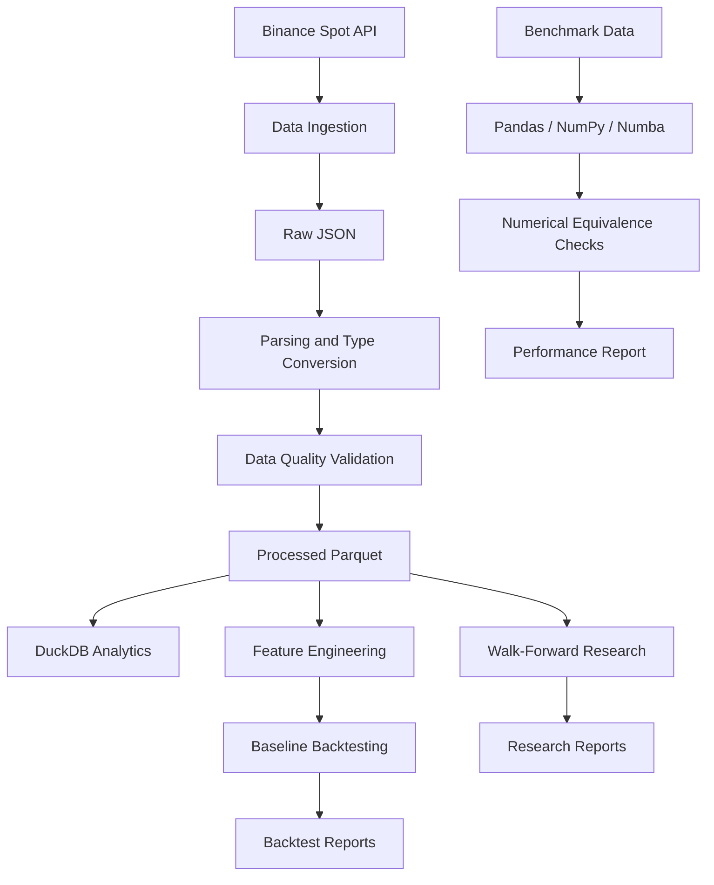

# Market Data Engineering & Quantitative Research Pipeline

A Python-based data engineering and exploratory quantitative research project using Binance Spot BTCUSDT market data.

The project demonstrates API ingestion, data quality validation, Parquet storage, DuckDB analytics, feature engineering, transaction-cost-aware backtesting, walk-forward evaluation, and numerical performance benchmarking.

> **Disclaimer:** This is an educational engineering and research project, not a trading bot, investment strategy, or financial recommendation.

## Key Features

- Paginated Binance Spot REST API ingestion
- OHLCV validation and timestamp integrity checks
- Raw JSON preservation
- Typed Parquet storage with PyArrow
- SQL analytics using DuckDB
- Returns, log returns, moving averages and rolling volatility
- Lagged long-only moving-average backtesting
- Shared multiplicative transaction-cost engine
- Expanding-window walk-forward evaluation
- Training-derived volatility filtering
- Pandas, NumPy and Numba performance benchmarking
- Automated tests with pytest

## Technology Stack

| Technology | Purpose |
|---|---|
| Python 3.11 | Main language |
| Requests | REST API integration |
| Pandas | Data manipulation |
| NumPy | Numerical computation |
| PyArrow | Parquet storage |
| DuckDB | SQL analytics |
| Numba | JIT optimization |
| pytest | Automated testing |
| psutil | Memory observations |

## Architecture



## Project Structure

```text
market_data_pipeline_project/
│
├── market_data/
│   ├── __init__.py
│   ├── __main__.py
│   ├── cli.py
│   ├── settings.py
│   ├── ingest.py
│   ├── quality.py
│   ├── storage.py
│   ├── costs.py
│   ├── features.py
│   ├── benchmark.py
│   ├── walk_forward.py
│   └── research_summary.py
│
├── data/
│   ├── raw/
│   └── processed/
│
├── reports/
│
├── tests/
│   ├── test_costs.py
│   ├── test_features.py
│   ├── test_quality.py
│   ├── test_storage.py
│   └── test_walk_forward.py
│
├── requirements.txt
├── README.md
├── PROJECT_PLAN.md
├── README_START_HERE.txt
└── .gitignore
```

Downloaded and processed datasets are excluded from Git.

## Installation

Requirements:
- Python 3.11
- Git
- Internet connection

Windows PowerShell:

```powershell
python -m venv .venv
.\.venv\Scripts\Activate.ps1
python -m pip install --upgrade pip
python -m pip install -r requirements.txt
```

If activation is blocked:

```powershell
Set-ExecutionPolicy -Scope Process -ExecutionPolicy Bypass
.\.venv\Scripts\Activate.ps1
```

## Running the Pipeline

### 1. Download Market Data

```powershell
python -m market_data.cli download --symbol BTCUSDT --interval 1m --days 180
```

The downloader uses Binance's public Spot kline endpoint and paginates through historical candles.

Output:

```text
data/raw/BTCUSDT_1m.json
```

### 2. Validate Data

```powershell
python -m market_data.cli validate --symbol BTCUSDT --interval 1m
```

Checks include:
- Duplicate timestamps
- Out-of-order records
- Missing candles
- Irregular timestamp gaps
- UTC interval alignment
- Invalid or non-finite numeric values
- Invalid OHLC relationships
- Negative volume
- Invalid trade counts

Missing candles are reported, not automatically filled.

Outputs:

```text
data/processed/BTCUSDT_1m.parquet
reports/BTCUSDT_1m_data_quality.json
```

### 3. DuckDB Analytics

```powershell
python -m market_data.cli analyze --symbol BTCUSDT --interval 1m
```

Calculates candle count, time range, closing-price statistics, high/low range, total volume and trade count directly from Parquet.

### 4. Feature Engineering and Baseline Backtest

```powershell
python -m market_data.cli backtest --symbol BTCUSDT --interval 1m
```

Features include:
- Percentage returns
- Log returns
- Simple moving averages
- Rolling volatility
- Lagged trading signals
- Position changes
- Equity curve and drawdown

The example uses a long-only moving-average strategy. Signals are shifted by one candle before application.

### 5. Transaction-Cost Engine

The shared implementation is located in:

```text
market_data/costs.py
```

Both baseline and walk-forward backtesting use the same multiplicative transaction-cost model.

Default assumption:
- One-way fee: 5 basis points
- Entry fee: charged
- Exit fee: charged
- Open terminal positions: liquidated when required

The model does not simulate actual exchange execution, bid-ask spread or slippage.

### 6. Performance Benchmark

```powershell
python -m market_data.cli benchmark --rows 1000000 --window 60 --repeats 5
```

Compares:
- Pandas rolling mean
- NumPy cumulative sum
- Numba JIT implementation

Numerical equivalence is checked against Pandas before runtime comparison. Numba compilation is performed before timing.

### 7. Walk-Forward Research

```powershell
python -m market_data.walk_forward
```

Current experimental configuration:

| Parameter | Value |
|---|---:|
| Fast SMA | 30 |
| Slow SMA | 120 |
| Confirmation | 10 candles |
| Volatility window | 60 candles |
| Volatility threshold | Training Q50 |
| One-way fee | 5 bps |
| Training windows | 60, 90, 120, 150 days |
| Test window | 30 days |

Every test window starts flat. Indicators use historical observations for warm-up, and volatility thresholds are calculated from training data only.

Output:

```text
reports/walk_forward_30_120_confirm10.csv
```

### 8. Research Summary

```powershell
python -m market_data.research_summary
```

Generates aggregated walk-forward results and per-fold filter improvements.

Output:

```text
reports/walk_forward_summary.csv
```

### 9. Automated Tests

```powershell
python -m pytest -v
```

Latest verified result:

**40 tests passed.**

Test coverage includes:
- Transaction-cost calculations
- Signal timing
- Feature generation
- Data quality validation
- UTC normalization
- DuckDB and Parquet operations
- Walk-forward position and evaluation behavior

## Experimental Results

Recorded on October 30, 2026 using 259,201 one-minute BTCUSDT candles covering approximately 180 days.

### Data Quality

| Metric | Result |
|---|---:|
| Candles | 259,201 |
| Duplicate timestamps | 0 |
| Missing candles | 0 |
| Invalid timestamp alignment | 0 |
| Invalid OHLC rows | 0 |
| Negative volume rows | 0 |
| Invalid rows | 0 |
| Status | PASS |

### Baseline Backtest

Default configuration: SMA 20/60.

| Metric | Result |
|---|---:|
| Gross return | -9.06% |
| Net return | -93.15% |
| Maximum drawdown | -93.32% |
| Round trips | 2,585 |
| Transaction-cost events | 5,170 |

The baseline illustrates how high trading frequency can create substantial transaction-cost drag.

### Walk-Forward Evaluation

| Variant | Compounded test return | Mean fold return | Mean fold drawdown | Round trips |
|---|---:|---:|---:|---:|
| No filter | -56.71% | -18.65% | -21.11% | 860 |
| Training Q50 filter | -47.55% | -14.77% | -16.19% | 642 |
| Buy & Hold | +28.44% | — | — | — |

The Q50 filter reduced round trips by approximately 25.3% and improved net returns relative to the unfiltered moving-average strategy in all four evaluated folds.

However, both moving-average variants underperformed Buy & Hold.

These four test windows are separate flat-start simulations compounded sequentially. The fourth fold overlaps a previously explored period, and the Q50 threshold was motivated by earlier exploratory experiments.

Therefore, these results are exploratory rather than an untouched prospective validation.

### Performance Benchmark Snapshot

One local benchmark run used one million synthetic values, a window of 60 and five repetitions.

| Implementation | Average runtime |
|---|---:|
| Numba JIT | 0.001697 s |
| NumPy | 0.007503 s |
| Pandas | 0.013862 s |

In that run, Numba was approximately 8.17 times faster than Pandas and 4.42 times faster than NumPy.

These are machine-specific measurements, not universal performance guarantees. RSS observations are approximate process-level measurements.

## Research Conclusions

The experiments suggest that volatility-based entry filtering can reduce trading frequency and transaction-cost drag in this particular moving-average setup.

However, the filter did not generate positive net returns or outperform the Buy & Hold benchmark.

The project's main contribution is its reproducible engineering and evaluation workflow, rather than a profitable trading strategy.

## Limitations and Future Improvements

- Evaluate a genuinely untouched prospective period.
- Expand historical market regimes.
- Improve realistic execution assumptions.
- Add slippage and bid-ask spread modeling.
- Add API retry and partial-response tests.
- Improve memory profiling.
- Add additional data-source reconciliation.
- Introduce continuous integration.
- Add environment locking for reproducibility.

## Disclaimer

This project is intended for educational data engineering and quantitative research.

Historical results do not predict future performance. The backtest does not model actual exchange order execution, spread, slippage, market impact or liquidity constraints.

No investment advice is provided.

## License

No license has been selected yet. Add a LICENSE file before permitting external reuse or redistribution.
